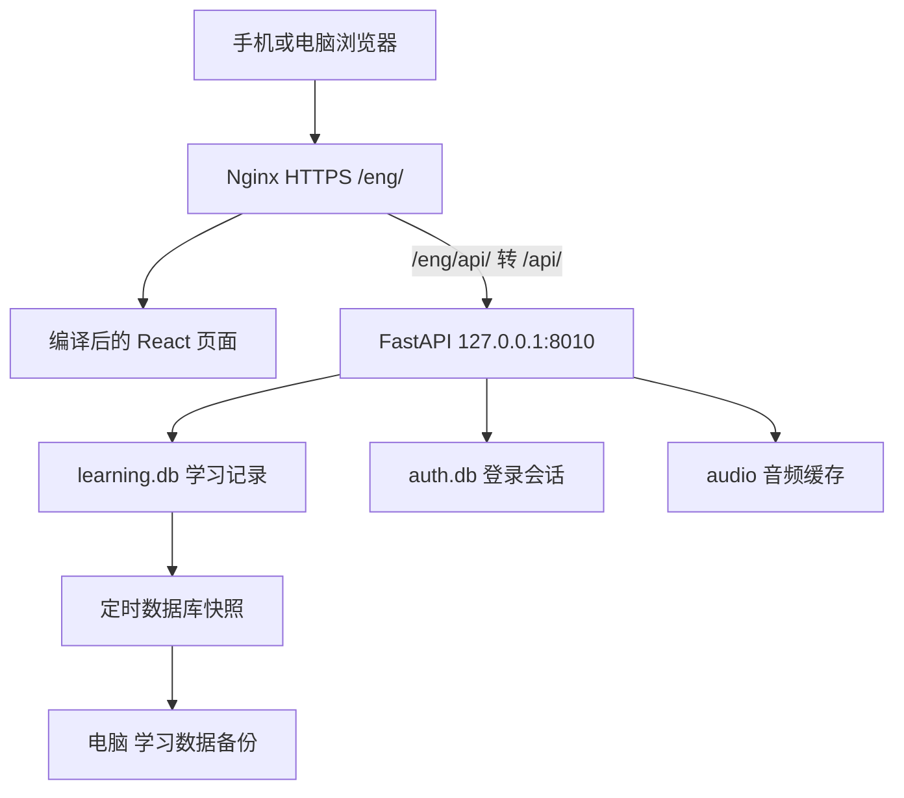

# 系统运行与学习流程

## 运行链路

本地开发链路是 localhost:5173 → Vite /api 代理 → localhost:8000。不是线上 8010。前端 apiBase.ts 根据构建 BASE_URL 生成路径，正式构建必须 --base=/eng/。

## 五个页面分别干什么

| 页面 | 职责 |
|---|---|
| 今日学习 | 从历史恢复当前题目，展示/书写/判题/反馈，驱动记录与复习更新 |
| 学习计划 | 每日新学和复习上限、当前课程、目录和单元进度 |
| 我的词典 | 查统一知识库及个人证据，查看记忆历史，不是另一套课程 |
| 学习档案 | 累计与连续天数、通过率、记忆曲线、分布、30天趋势、薄弱项、备份导出 |
| 设置 | 深浅/跟随系统、朗读、快捷键；本地有隔离测试模式，线上禁用 |

“今日学习”和“学习计划”使用用户自定课程及 `user_learning_*` 独立排程；“我的词典”负责课程导入和词典查询。当前前端学习入口不调用旧 `/api/next`、学习组或 FSRS 队列。旧学习档案和原始数据库记录仍保留作历史查看，详见39号说明。

## 一道题完整过程

1. 前端读取档案、设置和每日任务，请求 /api/next。
2. 后端按到期、当天巩固、新学额度、前置材料和课程选择安排内容；questions 保存题目身份。
3. 新知识可先展示讲解；回忆题展示中文，输入区不泄露英文。
4. 普通拼写达到要求自动检查；中文情境通过已实现的检查入口和答案集合判定。不要把任意长度输入都视为提交成功。
5. /api/check 保存拼写检查，返回正确/错误。最后改对不抹去本题先写错的证据。
6. 正确后进入释义。认识/模糊/忘记触发 /api/answers，正式保存答案与反馈，并在事务中更新该知识项状态和复习安排。
7. 返回查看旧题，选中上次反馈；改选走 /api/feedback 追加事件，重新计算受影响知识项，不伪造一次新练习。
8. 选择反馈后直接下一项，不需要“继续”。回看返回行为与新题状态不同。

拼写检查正确和完成正式反馈不是同一件事。只输入、检查而没有完成反馈，不能假定整轮记录和排程已经最终完成。

## 判断与提示

认识是自我反馈；独立通过还要求无提示、没有先写错、最终正确。看答案或听目标发音属于提示，当前题的发音入口应统一调用 pronounce，不能绕过 /reveal 记录而虚增独立成功。

大小写、首尾空白、连续空格、常见句末标点由 normalize 处理，不因为这些就全盘判错；仍可能提示 I 大写等书写习惯。单词拼写、动词形式和必要介词不能随便忽略。

## 发音

- 设置选择牛津且内容是单词时：后端查找并缓存美式 MP3，后续用服务器缓存。
- iPhone 其他内容：/api/pronunciation/device-us，Windows 本地用 Zira 等 US 声音生成 WAV，Ubuntu 用 espeak-ng；声音不会完全一样。
- 电脑其他内容：可使用浏览器设备声音。不能承诺浏览器合成会自动留下服务器缓存。
- 顶部中文/英文以及读音、音节区域可点击播放；释义页正文有其他发音入口。
- 首次自动发音受浏览器用户手势和 iOS 策略影响；“调用了播放”不证明真机一定发声。

## 手机限制

useViewport.ts 使用 visualViewport 处理软键盘可用高度；底部操作栏在输入框下方、键盘上方。Windows Chromium 模拟无法验证 iOS 真机键盘动画、静音开关和系统状态栏。键盘关闭慢一拍仍需真机观察，不要只凭模拟测试宣称完全消除。

电脑自动聚焦按鼠标/硬件输入能力判断，不按窗口宽度判断。窄版手机布局在电脑上也支持换词连续输入；聚焦逻辑统一在Study.tsx，触屏设备不强制弹出软键盘。

## 换题性能优化（2026-11-01）

/dashboard完整知识与历史仅在初次进入或主动重连读取；换题后调用/dashboard?summary_only=true，只返回计数，后端不执行全知识和最近100条历史查询。轻量统计异步更新，不包含在busy锁里，旧请求回包用版本号防止覆盖新统计。保存答案和请求下一题仍按顺序完成，不用假提交换速度。

独立测试把统计响应人为延迟3秒，393px和1280px电脑都完成三轮连续输入；86项后端测试通过。首次整列表加载仍存在，下一题本身仍有网络/服务器等待，不承诺零延迟。发布必须同时更新后端app.py和前端dist并重启后端，旧后端会忽略新查询参数而继续返回大列表。

## 完成页加学（替代原重新检查入口）

普通完成页询问是否继续学习，提供“再学10组 / 20组 / 50组”和“今天不学了”。选数字调用/api/daily-extra记录当天追加额度，再通过原/api/next进入学习；不修改长期daily-new-limit设置。

daily_extensions保存请求ID、上海自然日、请求组数和实际追加额。同ID重试不重复加额，跨日不复用旧请求。当天刷新/重启保留额外额度，次日不计入。学习计划new_limit展示今日有效上限，设置输入框仍为长期基础值。

每日加学仍遵守课程前置条件、12项巩固池和原复习规则，不等于强制把未掌握内容全部跳过。池满/仍有正常新学额度时接口会明确提示，不能重复点击绕过限制。“今天不学了”只改变完成页显示，不改数据库和次日计划。

加学只扩展新学数量，不增加复习上限；同项重复巩固仍不重复占新学组数。测试覆盖10/20/50、50+10、重复请求、跨日、重启和拒绝无效请求；89项后端测试通过，窄屏界面以隔离/mock请求检查过，不操作真实学习数据。

正式学习现已按学习组安排与计数，完整流程以12说明为准；旧逐项流程中的复习卡保存、反馈幂等和不阻塞输入仍有效。
